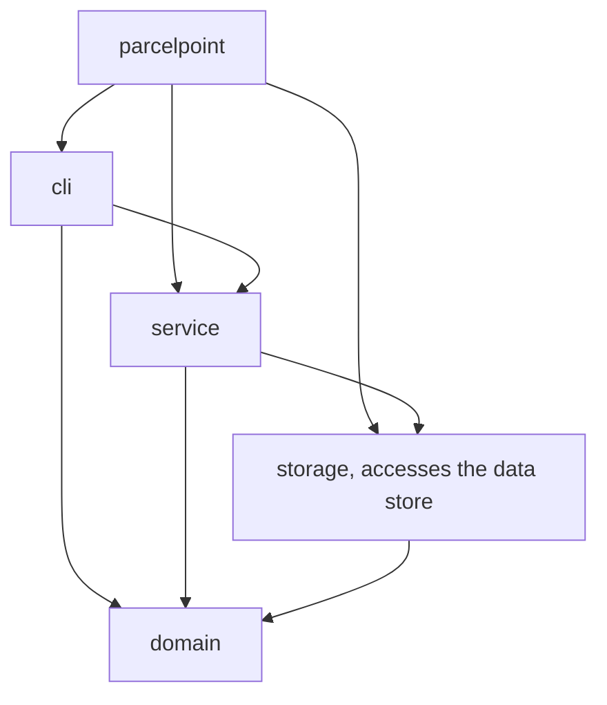
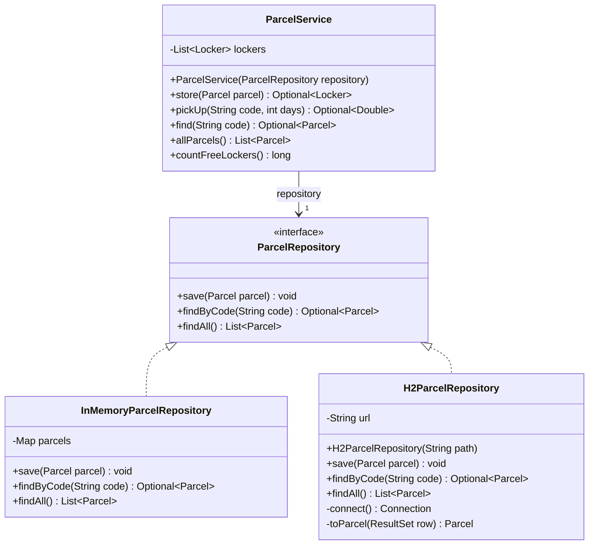
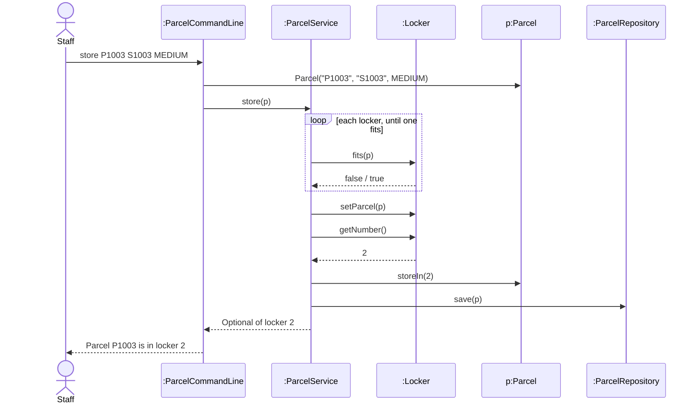

# Lab Report, Designing the Data Management Layer with H2

Repository URL: https://github.com/gmaaaaa/itcs382-h2-lab

## Tools

| Item | Version or name |
| --- | --- |
| JDK | 17.0.15 |
| Maven | 3.9.16 |
| IDE | Visual Studio Code 1.145.0 |
| AI tool and exact model, if you used one | Claude Code, Claude Opus 5.5 |

## Part 0. From a store in memory to H2

Commit of the starter, before any change: 620b586

0.3 Your prediction for `staff`, written before the second run:

I think `staff` will show no parcels and say that all 3 lockers are free, because the program does not save the parcels anywhere when it ends.

Output of the second run, for `staff` and `quit`:

```text
> staff
Free lockers: 3
> quit
```

State in one sentence where you think the parcels of the first run were kept.

The parcels were kept only in the memory of the running program (in the map inside InMemoryParcelRepository), so they were lost when the program ended.

0.5 The line of Main that you would change to keep the parcels somewhere else:

```java
ParcelRepository repository = new InMemoryParcelRepository();
```

0.6 Commit of the switch to H2: e0e4900

0.7 Output of `SELECT * FROM PARCEL;` after you stored two parcels:

```text
sql> SELECT * FROM PARCEL;
CODE  | STUDENT_ID | PARCEL_SIZE | STATUS | LOCKER_NUMBER
P1001 | S1001      | SMALL       | STORED | 1
P1002 | S1002      | LARGE       | STORED | 3
(2 rows, 40 ms)
```

0.8 Explain why ParcelPoint could not start while the H2 Shell was open, and identify the class that wrote the message `Cannot create the PARCEL table`.

ParcelPoint could not start because the H2 Shell already had the database file `parcelpoint.mv.db` open. H2 is an embedded database, so it locks the file, and only one program can use it at a time. The message `Cannot create the PARCEL table` was written by the class `H2ParcelRepository`, in its constructor, when it caught the `SQLException` from H2.

0.9 Explain why `staff` shows no parcel while `find` shows each one, and why all three lockers look free.

`find` uses `findByCode`, which really reads the row from the PARCEL table, so it finds each parcel. `staff` uses `findAll`, but in the starter `findAll` only returns an empty list (`List.of()`) and never reads the database, so `staff` shows no parcel. All three lockers look free because the constructor of `ParcelService` uses `findAll` to put each waiting parcel back into its locker when the program starts. The list is empty, so no locker gets a parcel.

0.11 Your findAll method:

```java
@Override
public List<Parcel> findAll() {
    String sql = "SELECT * FROM PARCEL ORDER BY CODE";
    List<Parcel> parcels = new ArrayList<>();
    try (Connection connection = connect();
         PreparedStatement statement = connection.prepareStatement(sql);
         ResultSet row = statement.executeQuery()) {
        while (row.next()) {
            parcels.add(toParcel(row));
        }
    } catch (SQLException e) {
        throw new IllegalStateException("Cannot read the parcels", e);
    }
    return parcels;
}
```

Commit that adds findAll: 931cfa1

0.12 Output of `SELECT * FROM PARCEL;` after the pickup:

```text
sql> SELECT * FROM PARCEL;
CODE  | STUDENT_ID | PARCEL_SIZE | STATUS    | LOCKER_NUMBER
P1001 | S1001      | SMALL       | PICKED_UP | null
P1002 | S1002      | LARGE       | STORED    | 3
(2 rows, 31 ms)
```

0.13 Optional. Describe what `find P9999'OR'1'='1` showed while the SQL was joined from strings, and what it showed after you put the placeholder back.

## Part A. Model the design

A1 Complete the flowchart with one node for each package and one arrow for each dependency, from the package that uses to the package that is used. Mark the package that accesses the data store.



State whether cli depends on storage, and explain why.

No, cli does not depend on storage. ParcelCommandLine imports only classes from domain and service, and it never names ParcelRepository or any repository class. It reaches the parcels only through ParcelService, so the data store can change without any change to cli.

A2 Complete the class diagram of the data management layer with ParcelService, the interface ParcelRepository with its three operations, and the two classes that implement it.



A3 Draw a sequence diagram for the command `store P1003 S1003 MEDIUM`, from the staff member to the repository. Show each message as an operation of the class that receives it.



Explain why the last lifeline is the interface ParcelRepository rather than H2ParcelRepository.

ParcelService only depends on the ParcelRepository interface, remaining completely independent of H2ParcelRepository. Main controls which data store is injected, meaning the same diagram applies to both implementations. This demonstrates the Dependency Inversion Principle: business logic relies on abstractions rather than concrete data stores.

## Part B. Design questions

1. Identify the files that you changed to move from the store in memory to H2, and explain why no other class had to change. Use the terms of this course.

Switching from the in-memory store to H2 only required changing Main.java (the import and repository creation) and updating findAll inside H2ParcelRepository.java. Because ParcelService relies on the ParcelRepository interface via dependency injection rather than a concrete class, no other files needed to change. This is the Dependency Inversion Principle in action: the business logic stays completely decoupled from the underlying data store.

2. The PARCEL table stores the size of a parcel as SMALL, MEDIUM or LARGE rather than as 1, 2 or 3. Identify the type of connascence between ParcelSize and the table in each case, and explain which one is weaker.

Storing SMALL, MEDIUM or LARGE gives connascence of name, because the table and ParcelSize must agree on the names. Storing 1, 2 or 3 gives connascence of convention (both must agree on what each number means), or of position if the number comes from the order of the enum. Connascence of name is the weaker one. The names are easy to read in the table, and a wrong name fails at once, but with numbers a change to the order of the enum would silently give old rows the wrong size.

3. Project Phase 2 asks for a data store that needs no separate server. Explain why an embedded database such as H2 meets this rule, and describe the limit of an embedded database that Step 0.8 showed.

H2 is an embedded database running as a library via `pom.xml`, storing data in a local file (`parcelpoint.mv.db`) and creating tables automatically on startup without needing an external server. However, because H2 locks the database file, only one process can access it at a time—which is why ParcelPoint failed to start while the H2 Shell had the file open.

4. State the data store that you would choose for your Project Phase 2 team, files or an embedded database, the requirement that drives the choice, and the package that will access it.

For our OCS project prototype, we chose file-based Java serialization (storing objects in `./data` as `plans.dat`, `sequences.dat`, and `frames.dat`) because data must persist after the program ends. Since this is a single-user CLI application that queries objects strictly by ID or state, it doesn't need SQL or an external database. 
Following the Dependency Inversion Principle, only the `ocs.persistence` package accesses the data store via `PlanRepository`, `SequenceRepository`, and `FrameRepository` interfaces. `OcsCli` instantiates these file classes directly—acting just like `Main` in the H2 lab.

## AI usage declaration
| AI Tool & Exact Model | Date | Purpose | Files or Answers Produced / Changed | How Output Was Verified |
| --- | --- | --- | --- | --- |
| Claude Code (Claude Opus 5.5) | 14 November 2026 | Step-by-step guidance through the lab | Explained the commands and code for Steps 0.1 through 0.12. | Executed every step independently and cross-checked the outputs against the lab sheet. |
| Claude Code (Claude Opus 5.5) | 14 November 2026 | Drafting answers and visual diagrams | Assisted in writing and reviewing responses for Part 0, Part A, and Part B, along with generating the Mermaid diagrams for Part A. | Cross-verified the generated answers and diagrams against the underlying Java code and actual runtime outputs. |
| Claude Code (Claude Opus 5.5) | 14 November 2026 | Error detection and code debugging | Corrected the SQL queries and resolved error handling for the `findAll` method in `H2ParcelRepository.java`. | Built the project using `mvn package`, ran the staff checks, and verified the correct output for both parcels and available lockers. |